# Gym Logger 🏋️‍♂️

<div align="center">

[](https://nextjs.org/)
[](https://react.dev/)
[](https://www.typescriptlang.org/)
[](https://tailwindcss.com/)
[](https://supabase.com/)
[](https://vitest.dev/)
[](https://developer.mozilla.org/en-US/docs/Web/Progressive_web_apps)
[](https://gymlogger-tau.vercel.app/)

<br />

**A personal, high-performance workout tracker engineered for real-world gym ergonomics and deep performance analytics.**

[Live Application](https://gymlogger-tau.vercel.app/) • [Core Architecture](#-architecture--data-model) • [Feature Tour](#-feature-showcase) • [Local Setup](#-getting-started-locally) • [Test Suite](#-test-suite--quality-assurance)

</div>

---

## 📸 Interface Showcase

<div align="center">

### 🖥️ Desktop Dashboard (Dark & Light)

| Dark Mode (Obsidian & Electric Mint) | Light Mode (Canvas Mint) |
| :---: | :---: |
| 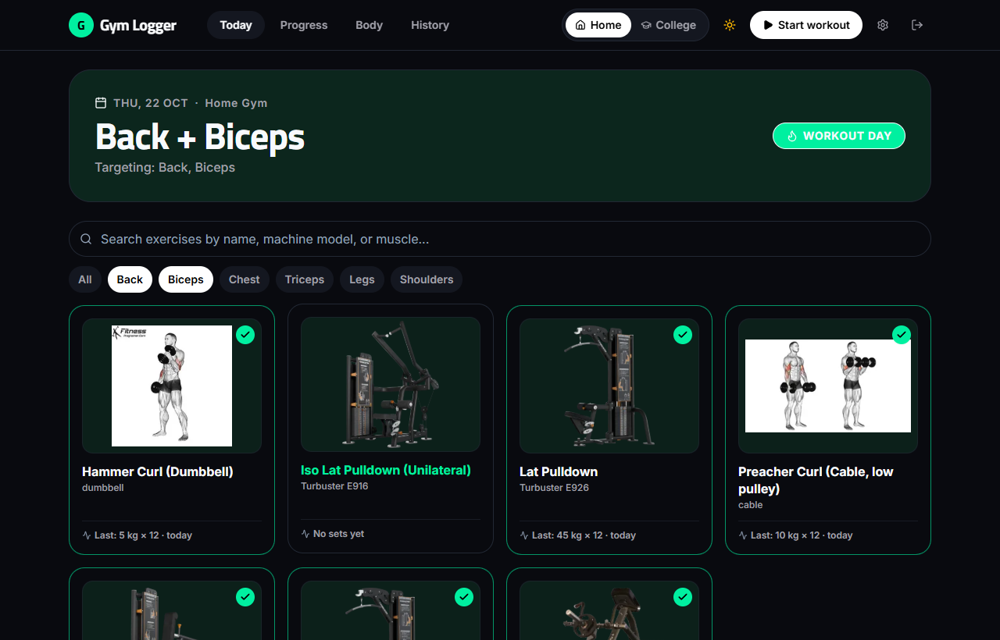 | 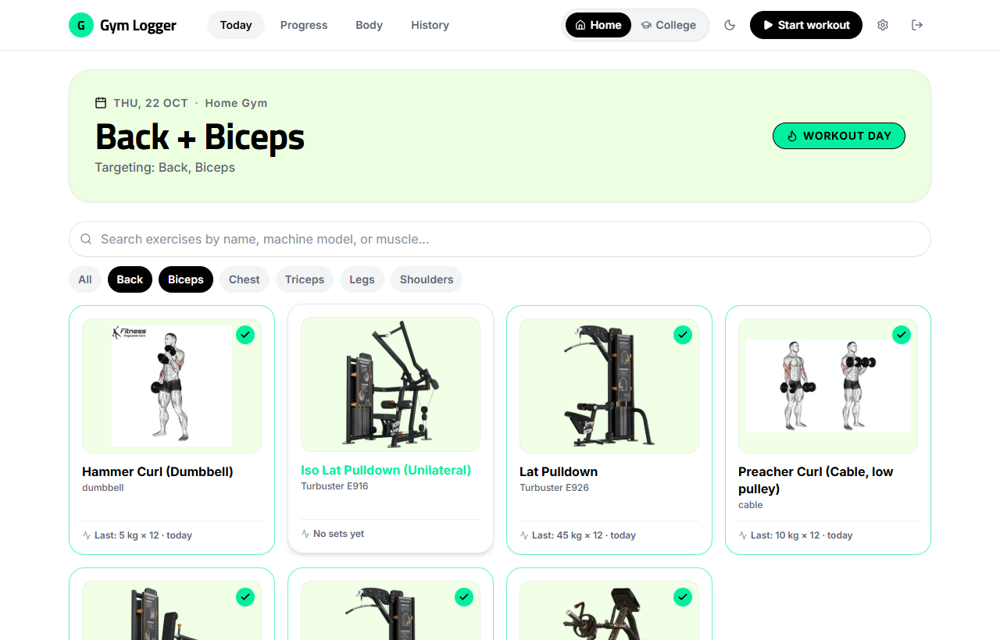 |

<br />

### 📱 One-Handed Mobile Ergonomics (390px Viewport)

| Today Workout Routine | Live Set Logging & PRs | Progress Analytics |
| :---: | :---: | :---: |
| 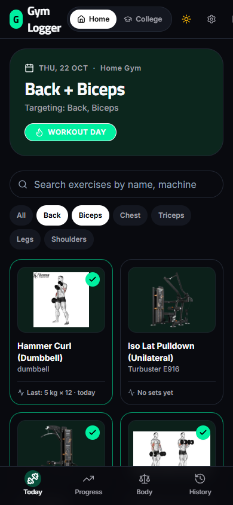 | 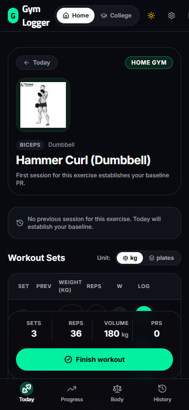 | 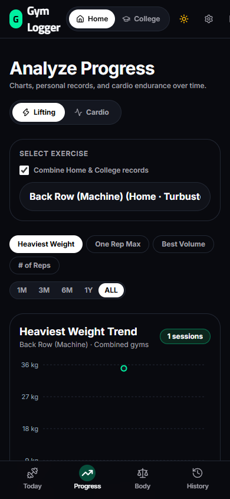 |

</div>

---

## 🌟 Highlights & Philosophy

Gym Logger is built for serious lifters who train across multiple gym environments and want the speed of a native mobile app without the bloat, ads, social feeds, or subscriptions of commercial trackers.

- **Zero Midnight Date Slippage**: Built strictly on Indian Standard Time (`Asia/Kolkata`). Vercel serverless UTC midnight never splits or offsets your calendar day.
- **Dual-Gym Engine (Home & College)**: Machine stacks and lever ratios vary across gyms. Gym Logger tracks PRs and exercises independently per gym with a one-tap header switch and optional cross-gym performance aggregation.
- **One Gym Per Calendar Day**: Enforces a strict one-session-per-day database rule with seamless location migration if you switch workout spots.
- **Jobright Design Aesthetic**: Dressed in electric spring-mint (`#00f0a0`), obsidian black (`#090a0f`), soft canvas-mint (`#ecffe0`), and high-contrast typography powered by **Titillium Web** and **Inter**.
- **Instant Set Logging**: Optimistic UI with segmented **kg ↔ plates** conversion, machine stack math, barbell per-side calculation, and live Epley 1RM recalculations.
- **PWA Ready**: Fully installable as a standalone Progressive Web App on iOS and Android with zero browser chrome.

---

## ⚡ Feature Showcase

### 1. Today Workout Dashboard (`/`)

- **Automatic Routine Split**: Detects today's day of week in IST and auto-selects the scheduled split (e.g., *Back + Biceps*, *Chest + Triceps*, *Legs + Shoulders*, or *Rest Day*).
- **Muscle Group Filter Chips**: Quickly toggle targeted muscle groups or customize today's routine on the fly.
- **Visual Equipment Cards**: Displays high-resolution machine photos (Turbuster, SportsArt, Grand Slam) with previous performance summaries and completion badges.
- **Everyday Cardio Tracker**: Quick logging for Treadmill speed (km/h), incline (%), and duration (minutes) with derived distance.
- **Active Workout Summary**: Real-time counter of total sets, lifted volume, and duration, finalized with a one-tap **Finish workout** action.

### 2. Hevy-Style Live Set Logging (`/log/[exerciseId]`)
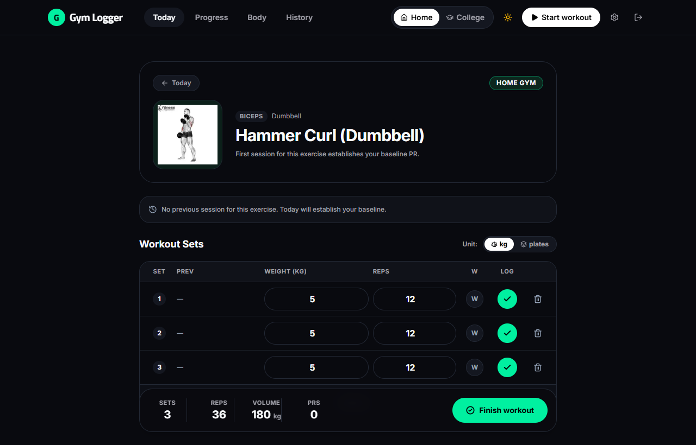
- **kg ↔ plates Segmented Switch**: Remembers preferred input mode per exercise.
- **Stack & Plate Math**:
  - Cable/Stack machines: `plates × kg_per_plate`
  - Barbell lifts: `bar_kg + 2 × (plates × kg_per_plate)` (plates per side)
- **Epley 1RM Calculation**: `Weight × (1 + Reps / 30)` calculated dynamically on working sets.
- **Live PR Medal**: Working sets that strictly break an all-time record display an instant neon mint `PR` badge. Baseline sessions automatically establish initial records without false badges.
- **Previous Session Copy**: One-tap pre-fill from your previous workout for effortless progressive overload.

### 3. Workout Progress & Records Board (`/progress`)
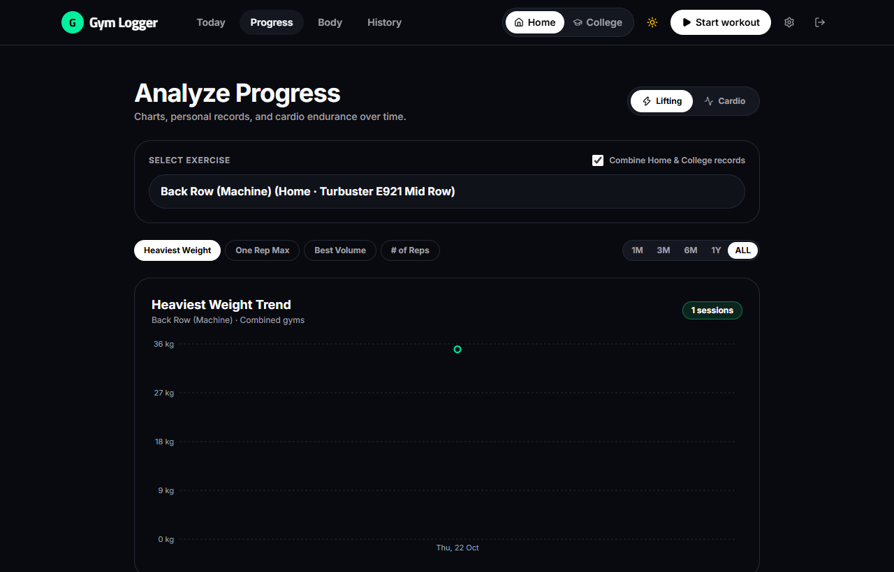
- **4 Hevy Analytics Metrics**:
  1. **Heaviest Weight**: Max weight lifted on a working set.
  2. **One Rep Max (1RM)**: Best theoretical single-rep strength.
  3. **Best Volume**: Peak single-set tonnage (`weight × reps`).
  4. **# of Reps**: Total volume and single-set endurance records.
- **Interactive Recharts Visualization**: Trendlines with mint data nodes, tooltips, and time horizon selectors (`1M`, `3M`, `6M`, `1Y`, `ALL`).
- **Combine Gyms Toggle**: Aggregate data across Home and College for exercises sharing a canonical slug.
- **Cardio Analytics**: Dedicated cardio endurance tracking with weekly duration trends.

### 4. Twice-Monthly Body Weight Engine (`/body`)
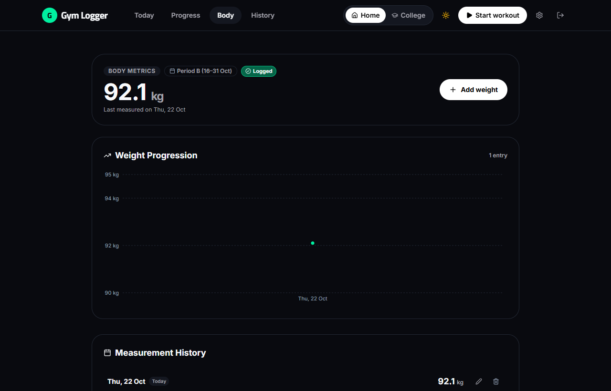
- **Automatic Period Determination**:
  - **Period A**: Days 1–15 of the month.
  - **Period B**: Days 16 through month-end.
- **Contextual Due Prompts**: When a weigh-in is due, an action prompt appears on the Today screen until logged or snoozed.
- **Progression Curve**: Visual body weight trendline with historical entry logs, inline edits, and date adjustments.

### 5. Workout History Archive (`/history`)
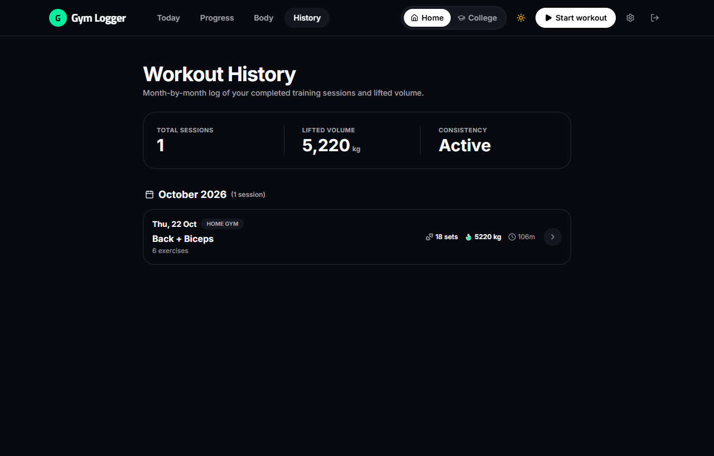
- **Month-Grouped Archives**: High-level training volume stats, total sessions, and consistency rating.
- **Session Drilldown (`/history/[sessionId]`)**: Detailed breakdown of every exercise, set, weight, and cardio log with full inline editing and deletion capabilities.

### 6. Catalog & Configuration (`/settings`)
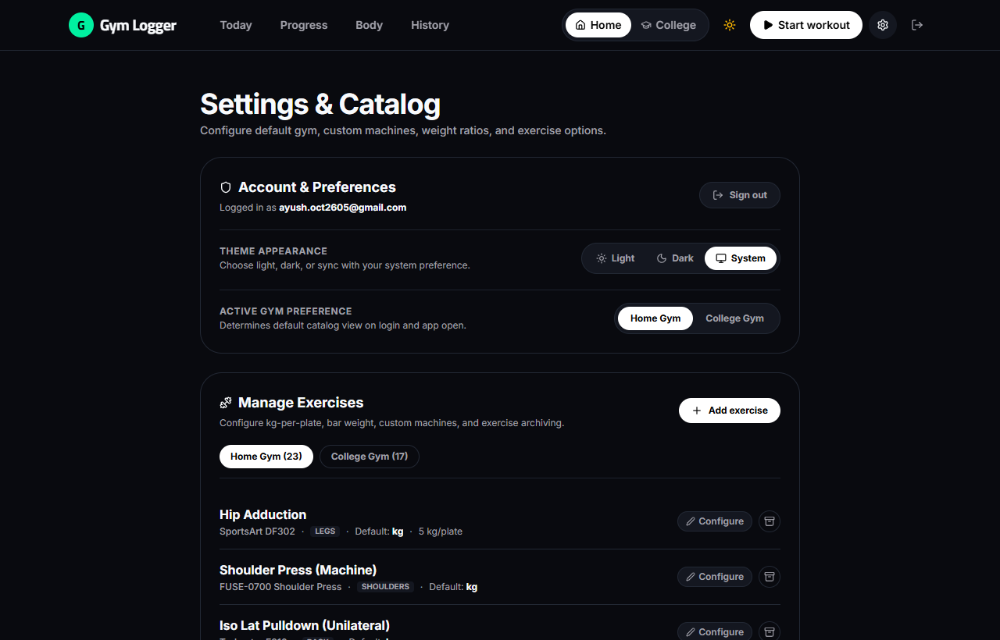
- **Exercise Management**: Add custom exercises, define default input modes, machine models, bar weights, and plate ratios.
- **Exercise Archival**: Keep current routines streamlined without losing historical PRs or past session logs.
- **Theme Appearance**: Select between **Light**, **Dark**, or **System** preference with zero-flash blocking scripts.
- **Default Gym Selection**: Configure default gym preference on login.

---

## 🛠️ Tech Stack

| Layer | Technology | Purpose |
| :--- | :--- | :--- |
| **Framework** | [Next.js 16 (App Router)](https://nextjs.org/) | Modern server-component architecture, Turbopack, and Server Actions |
| **Language** | [TypeScript 5](https://www.typescriptlang.org/) | Strict type checking with database-generated schema types |
| **Styling** | [Tailwind CSS v4](https://tailwindcss.com/) | Design tokens (`@theme`), dark mode engine, fluid typography |
| **Database & Auth** | [Supabase](https://supabase.com/) | PostgreSQL database with Row Level Security (RLS) & Supabase SSR Auth |
| **Charts** | [Recharts](https://recharts.org/) | Responsive SVG charts for lifting progression and body weight metrics |
| **Icons** | [Lucide React](https://lucide.dev/) | Clean, accessible iconography |
| **Typography** | [Next/Font](https://nextjs.org/docs/app/building-your-application/optimizing/fonts) | Titillium Web (display numbers & headings) + Inter (UI body) |
| **Testing** | [Vitest](https://vitest.dev/) | Unit test suite for IST time, PR calculations, units, and weigh-in logic |
| **Deployment** | [Vercel](https://vercel.com/) | Edge-optimized deployment with automatic CI/CD |

---

## 📐 Architecture & Data Model

```
gym_logger/
├── public/
│   ├── machines/               # Optimized WebP machine equipment photos
│   │   ├── home/               # Grand Slam & Turbuster machine equipment
│   │   └── college/            # College gym equipment
│   └── manifest.webmanifest   # PWA manifest
├── screenshots/                # Real production application screenshots
├── src/
│   ├── app/
│   │   ├── (auth)/login/       # Authentication screen & theme toggle
│   │   ├── (app)/layout.tsx    # App shell (Header, GymSwitch, BottomTabBar)
│   │   ├── (app)/page.tsx      # Today workout dashboard
│   │   ├── (app)/log/[id]/     # Live set logging & PR calculator
│   │   ├── (app)/progress/     # Progression charts & records board
│   │   ├── (app)/body/         # Body weight tracker & twice-monthly engine
│   │   ├── (app)/history/      # Session archives & workout details
│   │   └── (app)/settings/     # Exercise catalog & gym settings
│   ├── components/
│   │   ├── auth/               # LoginForm component
│   │   ├── body/               # BodyWeightChart, AddWeightModal, WeightHistory
│   │   ├── layout/             # AppHeader, GymSwitch, BottomTabBar, SignOut
│   │   ├── log/                # SetTable, LogHero, PreviousSetsPanel, RestTimer
│   │   ├── progress/           # ProgressView, RecordsBoard, CardioCharts
│   │   ├── theme/              # ThemeProvider, ThemeToggle
│   │   └── today/              # ExerciseGrid, ExerciseCard, CardioCard, WeighInPrompt
│   ├── lib/
│   │   ├── actions/            # Next.js Server Actions (auth, gym, workout, etc.)
│   │   ├── data/               # Server-side database fetchers
│   │   ├── supabase/           # Client, Server, and Middleware Supabase handlers
│   │   ├── prs.ts              # Epley 1RM and PR detection engine (+ tests)
│   │   ├── routine.ts          # Weekday-to-split routine mapping (+ tests)
│   │   ├── time.ts             # Pure Asia/Kolkata (IST) calendar functions (+ tests)
│   │   ├── units.ts            # kg <-> plates conversion algorithms (+ tests)
│   │   └── weighin.ts          # Twice-monthly Period A/B engine (+ tests)
│   └── types/database.ts       # Generated TypeScript database definitions
└── supabase/
    └── migrations/             # PostgreSQL schema with Row Level Security (RLS)
```

### Relational Schema Overview

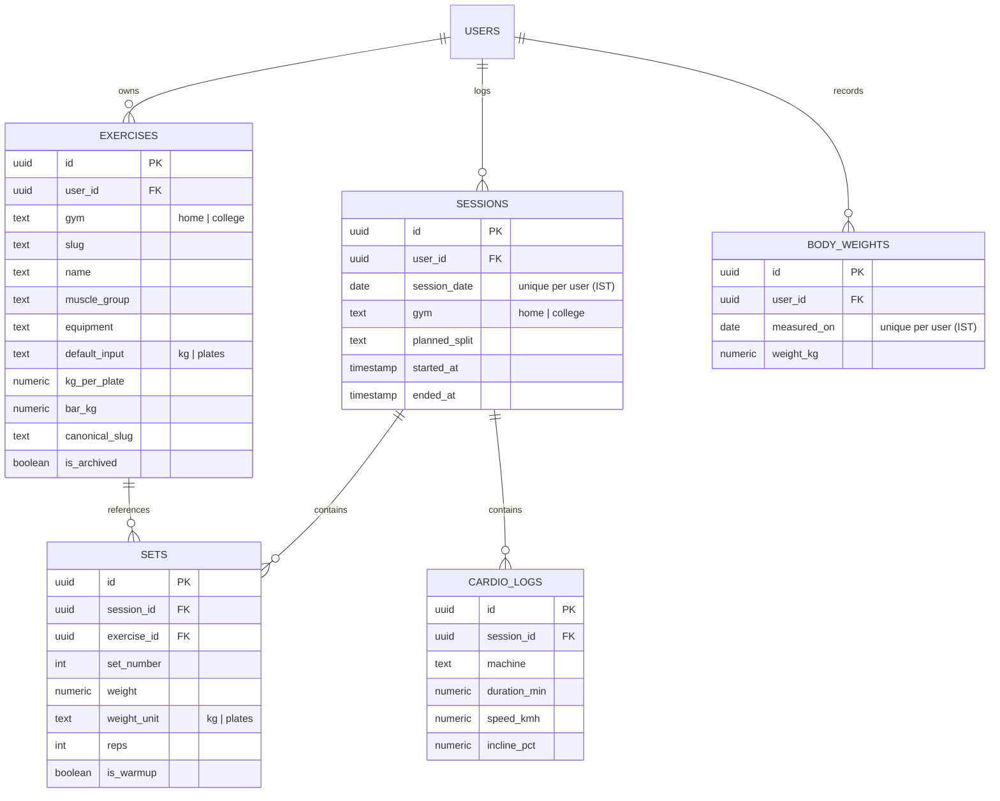

---

## 🔒 Security & Privacy

- **Row Level Security (RLS)**: Enforced across 100% of tables (`exercises`, `sessions`, `sets`, `cardio_logs`, `body_weights`). Every database read and write is scoped strictly to `auth.uid() = user_id`.
- **Public & Anon Protected**: Requests using anonymous keys receive zero rows unless fully authenticated.
- **Private Single-User Architecture**: Public registration is disabled; only the authorized administrator account can authenticate.
- **Zero Exposed Secrets**: No service-role keys are bundled in client or server runtimes.

---

## 🧪 Test Suite & Quality Assurance

The application features comprehensive unit testing covering all pure algorithmic domain logic in `src/lib/`:

```bash
npm run check
```

Executes the unified verification pipeline:
1. **ESLint**: Strict code quality and accessibility standards.
2. **TypeScript**: Full compiler typecheck (`tsc --noEmit`) with strict mode enabled.
3. **Vitest**: 51 comprehensive unit test assertions.

```
 ✓ src/lib/prs.test.ts (10 tests)
 ✓ src/lib/units.test.ts (9 tests)
 ✓ src/lib/routine.test.ts (3 tests)
 ✓ src/lib/theme.test.ts (3 tests)
 ✓ src/lib/time.test.ts (6 tests)
 ✓ src/lib/weighin.test.ts (13 tests)
 ✓ src/lib/today.test.ts (7 tests)

 Test Files  7 passed (7)
      Tests  51 passed (51)
```

### Domain Tests Cover:
- **IST Time Logic**: Strict date formatting and weekday calculations preventing midnight edge rollover at `00:30 IST` and `23:30 IST`.
- **Plate Conversion**: Accurate calculations for dumbbell (single hand), cable/pin stacks, and barbell per-side weight equations.
- **Epley Formula & PR Rules**: Strict record breaking verification, ignoring warm-up sets, handling ties, and baseline initialization.
- **Weigh-In Period Engine**: Boundary testing for Period A (1st–15th), Period B (16th–end), leap years, and month transitions.

---

## 🚀 Getting Started Locally

### 1. Prerequisites
- **Node.js**: `v20.9.0` or higher (`v24.x` recommended)
- **npm**: `v10.x` or higher
- A [Supabase](https://supabase.com/) project (Free tier)

### 2. Clone Repository
```bash
git clone https://github.com/ayusht26/gym_logger.git
cd gym_logger
npm install
```

### 3. Setup Environment Variables
Create a `.env.local` file in the root directory:
```env
NEXT_PUBLIC_SUPABASE_URL=https://your-supabase-project.supabase.co
NEXT_PUBLIC_SUPABASE_PUBLISHABLE_KEY=your-supabase-publishable-key
```

### 4. Database Setup
1. In your **Supabase Dashboard**, open the **SQL Editor**.
2. Run the initialization migration located at:
   `supabase/migrations/20261022000000_init.sql`
3. Seed the default exercise catalog for your user ID:
   ```sql
   select public.seed_default_exercises('your-supabase-user-uuid');
   ```

### 5. Start Development Server
```bash
npm run dev
```
Open [http://localhost:3000](http://localhost:3000) to view the application.

---

## 🌐 Deploying to Vercel

1. Push your repository to GitHub.
2. Import the project into [Vercel](https://vercel.com/).
3. Add the two environment variables in **Project Settings → Environment Variables**:
   - `NEXT_PUBLIC_SUPABASE_URL`
   - `NEXT_PUBLIC_SUPABASE_PUBLISHABLE_KEY`
4. In your **Supabase Dashboard → Authentication → URL Configuration**:
   - Add your production domain as the **Site URL** (e.g., `https://gymlogger-tau.vercel.app`).
   - Add `http://localhost:3000` under **Redirect URLs** for local development.
5. Deploy! Vercel builds the Next.js App Router application with Turbopack optimizations.

---

## 📄 License & Attribution

This project is personal open-source software built for private fitness tracking.
- Equipment photos and diagrams are copyright of their respective manufacturers (Grand Slam Fitness, Turbuster, SportsArt) and are used strictly for private non-commercial workout identification.
- Design inspiration from [Jobright.ai](https://jobright.ai/) and [Hevy](https://hevy.com/).
